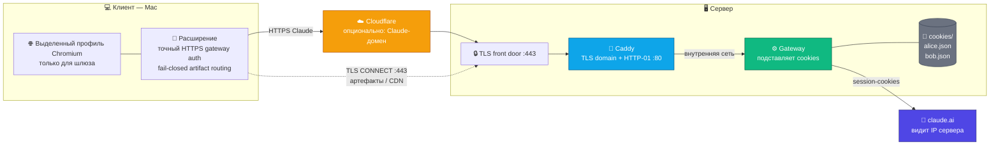
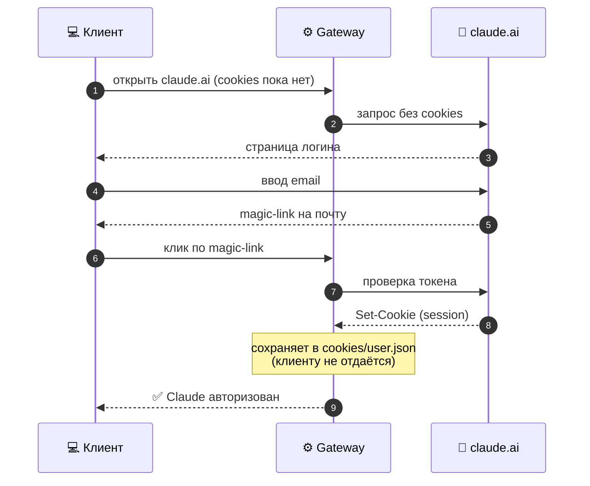

# claude_for_browes

Доступ к веб-интерфейсу Claude.ai через собственный шлюз. Обычные запросы Claude проходят через gateway, который хранит session-cookies на сервере и подставляет их к разрешённым upstream-запросам. Поддерживаемые артефакты сохраняют исходный browser origin и используют отдельный защищённый HTTPS CONNECT-маршрут. Основной интерфейс работает в браузере клиента.

Claude получает обычные запросы с IP сервера, а не клиента. Клиентский browser напрямую подключается к IP сервера для HTTPS CONNECT к artifact/CDN-доменам, поэтому этот IP виден клиентской сети. Cookies Claude хранятся на сервере. Использование прокси не гарантирует доступность сервиса и может противоречить условиям Anthropic.

## Как это работает



**Что видит каждая сторона:**

| Сторона | Видит |
|---|---|
| Провайдер клиента | видит IP сервера и метаданные прямого CONNECT; TLS содержимое CONNECT остаётся зашифровано |
| Cloudflare (если включён) | клиентский IP и HTTPS-трафик Claude-домена до шлюза |
| **Claude** | upstream-запросы с IP сервера и session-cookies |
| **Оператор CONNECT** | TLS-туннель до разрешённого artifact/CDN host; внутреннее TLS-содержимое остаётся зашифровано до browser origin |

### Предполагаемый вход через gateway



Это описание ожидаемого cookie-capture потока, а не подтверждение полного публичного magic-link/OAuth E2E. Google/Apple OAuth может завершиться `origin_mismatch`; текущая проверка такого входа не подтверждена.

**Компоненты:**

- **Gateway** (`gateway/gateway.js`) — прокси для фиксированного списка upstream hostnames; хранит cookie-jar на пользователя, удаляет чувствительные заголовки и не отдаёт `Set-Cookie` браузеру. Отдельный TLS CONNECT listener ограничен artifact-доменами и явным списком CDN.
- **TLS front door + Caddy** — front door принимает публичный TCP 443 и направляет соединения по TLS/CONNECT. Caddy обслуживает HTTPS gateway, HTTP-01 для сертификата IP и HTTP на порту 80. Gateway listeners доступны только внутри Docker-сети.
- **Расширение браузера** (`extension/`) — основной клиентский вариант Chromium: точный gateway HTTPS-origin используется напрямую, а разрешённые артефакты/CDN идут через TLS CONNECT после проверки gateway. Неизвестные адреса блокируются во всём выделенном профиле. Фактическую совместимость проверяйте для выбранной версии. Firefox сейчас fail-closed для artifact CONNECT; previews не подтверждены. См. [SECURITY.md](SECURITY.md).

## Структура репозитория

| Путь | Что это |
|---|---|
| `gateway/gateway.js` | прокси с подстановкой cookies (Node, без зависимостей) |
| `server/compose.yaml` | Docker Compose: TLS front door, gateway и Caddy |
| `server/Caddyfile.template` | доменный вход, Basic auth, HTTP-01 выпуск IP-сертификата |
| `server/add-user.sh`, `remove-user.sh` | добавить/сменить пароль/удалить пользователя |
| `server/backup.sh`, `restore.sh` | зашифрованный бэкап и восстановление |
| `extension/` | расширение Chrome/Edge и Firefox (Manifest V3), `build.sh` собирает оба пакета |
| `tests/` | unit, integration и браузерные проверки; см. фактический итог конкретного запуска |
| `SECURITY.md` | модель угроз, что проверено, ограничения |
| `install.sh` | **поэтапный интерактивный установщик сервера** (рекомендуется) |
| `configure.sh` | подставляет ваш домен в шаблоны |
| `docs/DEPLOY-SERVER.md` | подробная настройка сервера |
| `docs/SETUP-CLIENT.md` | подробная настройка клиента (Mac) |
| `docs/MULTI-USER.md` | пользователи, изоляция и эксплуатационные ограничения |

---

# Установка

## Быстрый старт (рекомендуется)

На сервере (Ubuntu/Debian, root):

```sh
git clone <этот-репозиторий> && cd claude_for_browes
bash install.sh
```

Интерактивный установщик подготовит доменный адрес и публичный IP, `.env`, отдельный каталог деплоя, расширения, ключи и резервное копирование. Требуются открытые входящие TCP 80 и 443. См. [инструкцию сервера](docs/DEPLOY-SERVER.md) и проверяйте вывод установщика после завершения.

После установки готовые расширения раздаются сервером по **`https://<домен>/__ext/`** за Basic auth. Выдайте клиенту ссылку, логин и пароль.

Есть управление пользователями, просмотр статуса сессий для администраторов, опциональные Telegram-уведомления и зашифрованные резервные копии. Cookies at rest шифруются, когда задан `COOKIES_KEY`; защита и оставшиеся ограничения описаны в [SECURITY.md](SECURITY.md).

Рекомендация по масштабу: **один сервер (один IP) на одного клиента/группу** — так аккаунты разных клиентов не смешиваются под одним IP.

Дальше — настройка клиентского браузера. Архитектура и требования к серверу описаны в [docs/DEPLOY-SERVER.md](docs/DEPLOY-SERVER.md); установка выполняется через `install.sh`.

## Часть 1. Сервер

Серверный гайд описывает TLS front door, Caddy, gateway, `PUBLIC_HOST`, `CONNECT_HOST`, HTTP-01 и сертификат IP. Он не заменяет установщик. Не запускайте старую двухконтейнерную схему из инструкций предыдущих версий.

---

## Часть 2. Клиент (Mac)

Настройка на машине каждого клиента. ~5 минут.

### Что выдать клиенту

- Текущую Chromium-сборку либо готовый пакет с `https://<домен>/__ext/` за логином/паролем
- Gateway host (например `claude.example.com`)
- Его basic_auth **user** и **password**

### Шаг 1. Создайте отдельный профиль браузера

1. Создайте отдельный профиль и используйте его только для этого расширения.
2. Пока расширение активно, оно ограничивает сетевые запросы этого профиля: неизвестные внешние адреса, открытые из Claude, блокируются; WebRTC privacy policy также относится ко всему профилю.
3. Не используйте защищаемый профиль для обычного веб-сёрфинга или других приложений.

Не используйте пакеты из `releases/` с версией 1.8.14: они предшествуют защищённому CONNECT-маршруту. Используйте Chromium-сборку версии 2.0.5 или новее и Chrome 125+; Firefox 140+ остаётся fail-closed для artifact CONNECT.

### Шаг 2. Установите расширение

**Chrome / Edge:** `chrome://extensions` → **Режим разработчика** → **Загрузить распакованное**. Для исходников выберите `extension/dist/chrome`; если получили zip с сервера, распакуйте его и выберите папку, где лежит `manifest.json`.
После загрузки откройте **Настройки** расширения, введите домен шлюза и нажмите «Сохранить и разрешить». Браузер запросит доступ к нужным адресам — подтвердите.

Firefox manifest требует ≥ 140, но Firefox не поддерживается для полной работы: artifact CONNECT намеренно fail-closed до проверки безопасного lifecycle.
В настройках укажите Gateway host, свой gateway user и password. Chromium-сборке требуется разрешение `debugger`; Chrome показывает предупреждение об этом при установке. Оно нужно для ограниченной обработки ответов артефактов. При подключённой вкладке шлюза будет виден системный баннер отладки. После обновления расширения перезагрузите его на странице extensions и сделайте hard reload страницы Claude.

### Шаг 3. Проверьте защиту

В настройках и popup расширения убедитесь, что отображается активный защищённый маршрут. Если маршрут не готов, неизвестные внешние запросы останутся заблокированными. Не считайте fingerprint включённым, пока расширение явно не подтвердило его регистрацию. Режим WebRTC меняет настройки всего выделенного профиля.

### Шаг 4. Пользуйтесь Claude

Откройте `https://claude.ai` в этом профиле. Он загрузится через шлюз с уже авторизованной сессией.

- Claude работает в браузере клиента; поддерживаемые артефакты могут открываться через отдельный CONNECT tunnel.
- В Chromium подходящие artifact responses обрабатываются только в точном профиле/вкладках gateway: расширение добавляет gateway origin в `frame-ancestors`, сохраняя остальные CSP-политики. Совместимость реального preview зависит от страницы и пока не гарантируется; DevTools может занять debugger и привести к fail-closed блокировке артефакта.
- Inline artifact response, для которого нужно менять заголовки, ограничен буфером 8 MiB; attachment-загрузки проходят по штатному download-пути браузера без буферизации этим механизмом. Успешная работа каждого типа артефакта, загрузки и OAuth не гарантирована; известные ограничения перечислены в [SECURITY.md](SECURITY.md).

---

# Диагностика проблем

| Симптом | Решение |
|---|---|
| Зацикленное окно логина браузера | Заново введите креды в Options расширения, затем обновите расширение (⟳ на `chrome://extensions`) |
| Claude просит логин | Сессия протухла — просто залогиньтесь снова через шлюз (magic-link), cookies перехватятся автоматически |
| Шрифты сломаны | Hard reload: ⌘+Shift+R |
| Артефакт или внешний компонент заблокирован | Адрес не входит в проверенный allowlist. Не добавляйте произвольные домены; проверьте текущую совместимость и журнал релиза. |
| 401 на `/v1/code/*` или ассетах | Убедитесь, что gateway обновлён (удаляет `authorization` перед форвардингом) |

---

# Обновление cookies (когда сессия истечёт)

Когда Claude снова покажет логин — пользователь входит заново через шлюз, cookies перехватываются автоматически. Ничего делать на сервере не нужно.

---

# Несколько клиентов (multi-client)

Шлюз **из коробки** обслуживает много пользователей, у каждого свой Claude-аккаунт и свои cookies:

- cookies хранятся по пользователям (`gateway/cookies/<user>.json`)
- на каждого клиента — свой basic_auth-пользователь в Caddy
- gateway выбирает cookie-файл по авторизованному basic_auth-пользователю (заголовок `X-Remote-User`)
- пользователь логинится сам через шлюз (magic-link) — шлюз перехватывает его cookies

Добавить пользователя: `./server/add-user.sh <имя> <пароль>`

**Архитектура пользователей и ограничения: [docs/MULTI-USER.md](docs/MULTI-USER.md)**

---

# Безопасность

Весь код открыт — проверьте сами: `gateway/gateway.js` (прокси), `extension/` (расширение), `server/` (Caddy + docker). Подробный разбор — **[SECURITY.md](SECURITY.md)**. Коротко:

- Cookies хранятся на сервере; at-rest encryption зависит от заданного `COOKIES_KEY`.
- Отдельный proxy token применяется только к разрешённым artifact/CDN-доменам. После успешного mint новый токен отзывает только точный previous bearer token, который прислал этот клиент, даже при смене аккаунта; ошибка выдачи нового токена не отзывает действующий. Если затем не проходит проверка маршрута, маршрутизация остаётся закрытой, а выданный кандидат сохраняется для retry. До открытия artifact routes расширение делает фиксированный HTTPS HEAD без тела через защищённый CONNECT.
- Default runtime logger Caddy удаляет request URI и headers, включая query/cookies/auth headers; диагностические сообщения и логи других компонентов отдельно не очищаются. При обновлении Caddyfile пересоздайте контейнер Caddy.
- Входящие порты: TCP 80 для HTTP-01 и TCP 443 для front door. Gateway 8088/8443 остаются внутренними.
- Firefox artifact routing fail-closed; OAuth origin mismatch и CSP-ограничения артефактов остаются известными ограничениями.
- Для 2.0.5 прошли 148 Node.js и 29 Python-тестов без пропусков, Firefox lint без замечаний и independent native HTTP/2 gate 18/18 с точным synthetic fetch→Blob→download. Изменение пропускает только пустой `responsePhrase` (HTTP/2 не задаёт reason phrase) и сохраняет непустое значение. В ограниченной публичной проверке прошли HTML export, PDF download, React, Markdown и конкретные существующие SVG/Mermaid previews. Это не подтверждает каждый формат, legacy MIME-маршрут или полное покрытие артефактов. Из 29 проверенных защищённых ответов у 18 наблюдался ожидаемый proxy IP:443, у 11 адрес неизвестен; эта выборка не доказывает отсутствие прямого egress для всех запросов профиля. Подробности и ограничения — в [SECURITY.md](SECURITY.md).
- На публичном прогоне 2.0.4 запрос получил HTTP 200 и ожидаемый CORS-заголовок, но Chromium отклонил ответ инспектора: HTTP/2 передал пустой status text, а расширение передало его как пустой `responsePhrase`; CDP вернул `-32602`, после чего запрос был заблокирован до получения байтов и загрузки. Это не была CORS-ошибка. Кандидат 2.0.5 пропускает пустое поле. Старый Cloudflare gzip object связан с отдельной ошибкой декодирования HTTP 200 script; исходный URL не очищен вручную, а причина исторических 525 остаётся неизвестной.
- Не считайте выборочную проверку гарантией поддержки всех артефактов или публичного production deployment.

---

# Лицензия

MIT — см. [LICENSE](LICENSE).
